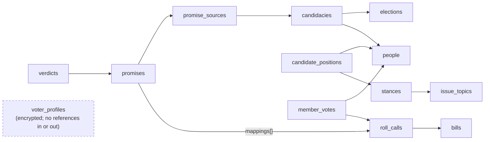

# Informed — ZeroDB Data Model

As of Oct 15, 2026 · Toby Morning · Companion to the Informed PRD

## Storage map

Informed runs on one ZeroDB project with no dedicated Postgres: NoSQL tables are the system of record, and vectors, the knowledge graph, files and events are derived from them. FastAPI reaches every primitive through the [ZeroDB MCP server](https://glama.ai/mcp/servers/AINative-Studio/ainative-zerodb-mcp-server/tree).

| Data | ZeroDB primitive | MCP tools | Why |
| --- | --- | --- | --- |
| All records: people, candidacies, bills, roll calls, member votes, promises, verdicts, positions, governance | NoSQL tables | `zerodb_create_table`, `zerodb_insert_rows`, `zerodb_query_rows`, `zerodb_update_rows` | System of record; schema-flexible as jurisdictions are added |
| Voter interest profiles (versioned) | NoSQL table, encrypted payload | same | Per-user documents; app-layer encryption |
| Promise, bill-summary, topic and stance embeddings | Vectors | `zerodb_embed_and_store`, `zerodb_semantic_search` | Promise-to-bill matching, free-text interest mapping |
| Evidence graph (candidate → promise → vote → stance) | Knowledge graph | `zerodb_graph_ontology_upsert`, `zerodb_graph_upsert_entity`, `zerodb_graph_create_edge`, `zerodb_graph_rag_search` | Grounded answers, traversal, contradiction detection |
| Archived campaign pages, bill text, transcripts | Files | `zerodb_upload_file`, `zerodb_generate_presigned_url` | Immutable snapshots behind every citation |
| Ingest, verdict and profile changes | Events | `zerodb_create_event`, `zerodb_subscribe_events` | Rebuild read models and send alerts without polling |
| Q&A sessions, reviewer feedback | Memory + RLHF | `zerodb_store_memory`, `zerodb_rlhf_*` | Short-lived agent context; QA decisions feed Focustem |

**NoSQL design rules** (because there are no joins or foreign keys)

1. **Deterministic ids from natural keys** — e.g. roll call `us-house:119-2:452`, member vote `us-house:119-2:452:B000944`. Re-ingesting the same record is an idempotent upsert, never a duplicate.
2. **Denormalize for the read** — each row carries the fields its main query filters on (a member vote carries `voted_at`, `vote_type`, `bill_id`, `topic_ids`), so every screen is one filtered query on one table.
3. **Embed what is always read together** — terms inside `people`, sponsors inside `bills`, mappings inside `promises`.
4. **Read models for hot pages** — `candidate_cards` is rebuilt from events, so the ballot view never aggregates at request time.
5. **Integrity lives in code** — a FastAPI repository layer validates references with Pydantic before every write; contract tests cover each rule.
6. **Append-only where history matters** — verdicts, positions and the provenance log are never updated in place; an `is_current` flag marks the live row.

## How the tables reference each other

The tables have no foreign keys, only id references that the repository layer checks. The voter's profile is deliberately cut off from everything else. Arrows point from a row to the row it references by id.



Scoring reads two paths: `member_votes` by person and topic for the voting record, and `promises` → `verdicts` for the Promise vs. Record view. `candidate_cards` (not shown) is a read model rebuilt from these tables by events. Governance tables (`methodology_versions`, `corrections`, `audit_runs`, `provenance_log`) reference rows by `target_table` + `target_id`.

## NoSQL table specs

There are 22 NoSQL tables, each created with `zerodb_create_table` and a field-type schema. Ids are strings built from natural keys. Per-user alignment scores are never stored: they are computed per request from `candidate_positions`, so no table links a person's priorities to a candidate.

### Reference and people

| Table | id pattern | Fields | Main queries |
| --- | --- | --- | --- |
| `jurisdictions` | `us-federal`, `eu`, `uk` | name, country_code, level, adapter_name, active | All active |
| `bodies` | `us-house`, `us-senate` | jurisdiction_id, name, chamber, seats | By jurisdiction |
| `districts` | OCD-ID (`ocd-division/country:us/state:ca/cd:19`) | body_id, name, state, valid_from, valid_to | By id after address geocode |
| `people` | `person:{bioguide}` or `person:{uuid}` | canonical_name, external_ids, photo_url, **terms[]** (body_id, district_id, party, start, end) | By id; by external id |
| `elections` | `us-2026-11-03-general` | jurisdiction_id, name, election_date, kind | Upcoming by jurisdiction |
| `candidacies` | `{election_id}:{district_id}:{person_id}` | election_id, district_id, person_id, person_name, party, is_incumbent, status | By (election, district) → ballot view |
| `issue_topics` | `{locale}:{slug}:v{n}` | parent_id, name, locale, taxonomy_version | Tree by locale |
| `stances` | `{topic_id}:{slug}` | topic_id, label, description, direction_code, wording_version | By topic |

### Legislative record

| Table | id pattern | Fields | Main queries |
| --- | --- | --- | --- |
| `bills` | `{body}:{session}:{number}` (`us-house:119:hr-1234`) | title, summary, status, introduced_on, subjects[], topic_ids[], **sponsors[]** (person_id, role, joined_on), text_file_id, source_url | By id; by topic; by sponsor |
| `roll_calls` | `{body}:{session}:{roll}` (`us-house:119-2:452`) | voted_at, question, vote_type, bill_id, amendment_ref, result, tally {yea, nay, present, not_voting}, is_bundled, topic_ids[], source_url, content_hash | By bill; by date range |
| `member_votes` | `{roll_call_id}:{bioguide}` | roll_call_id, person_id, position, *voted_at, vote_type, bill_id, topic_ids[], is_bundled* (copied from the roll call) | By (person, topic) → scoring; by roll call |

`vote_type` takes `final_passage`, `amendment`, `cloture`, `motion_to_recommit`, `procedural` or `other`; `position` takes `yea`, `nay`, `present` or `not_voting`. The italic fields are denormalized copies so scoring reads one table.

### Promises, verdicts and positions

| Table | id pattern | Fields | Main queries |
| --- | --- | --- | --- |
| `promise_sources` | `src:{sha256}` | candidacy_id, source_type, url, archived_file_id, captured_at | By candidacy |
| `promises` | `prm:{uuid}` | candidacy_id, person_id, source_id, quote_span, actor, action, object, direction, topic_id, stance_id, testable, extractor_version, confidence, vector_id, **mappings[]** (bill_id, roll_call_id, effect, confidence, qa_status), qa_pending | By person; QA queue (`qa_pending = true`) |
| `verdicts` | `{promise_id}:v{n}` | promise_id, person_id, verdict, confidence, methodology_version, qa_status, reviewed_by, reviewed_at, is_current, created_at | Current by person |
| `candidate_positions` | `{person_id}:{stance_id}:{method_ver}` | person_id, stance_id, s_value (−1 to 1), confidence, evidence_count, basis, is_current, computed_at | Current by person |
| `candidate_cards` (read model) | `{candidacy_id}` | person_name, party, district, photo_url, verdict_counts {kept, partial, broken, …}, say_do_gap, positions_summary, updated_at | By (election, district) |
| `candidate_statements` | `stm:{uuid}` | person_id, verdict_id, body, verified_by, posted_at | By verdict |

`verdict` takes `kept`, `partial`, `broken`, `no_opportunity`, `absent` or `not_testable`; `qa_status` takes `pending`, `approved` or `rejected`; `effect` takes `advances`, `opposes` or `neutral`.

### Governance, provenance and users

| Table | id pattern | Fields | Main queries |
| --- | --- | --- | --- |
| `methodology_versions` | `2026.1` | published_at, weights {tiers, evidence_blend, vote_types}, changelog_url, is_current | Current |
| `corrections` | `cor:{uuid}` | target_table, target_id, body, contact_email (optional), status, sla_due_at, resolved_at | Open by SLA |
| `audit_runs` | `aud:{date}` | run_at, methodology_version, max_delta, passed, report_file_id | Latest |
| `provenance_log` | `prov:{sha256}` | entity_table, entity_id, source_url, fetched_at, adapter_version | By entity |
| `voter_profiles` | `vp:{hmac(user_id)}` | version, locale, updated_at, **payload** (encrypted interests) | By id only |

## Voter profile document

A profile row stores only what is needed to find and decrypt it. The interests themselves sit in an AES-256-GCM `payload` encrypted with a per-user data key, so ZeroDB never sees a voter's political priorities in clear text. The row id is an HMAC of the user id, so a database dump cannot be joined back to accounts.

```json
{
  "id": "vp:9f2c…e41a",
  "version": 7,
  "locale": "en-US",
  "jurisdiction_ids": ["us-federal"],
  "updated_at": "2026-10-15T19:20:00Z",
  "key_ref": "kms:informed/users/v1",
  "payload": "base64(AES-GCM ciphertext)"
}
```

Decrypted payload (validated by the Pydantic `InterestProfile` model):

```json
{
  "interests": [
    {"topic_id": "en-US:rx-drug-pricing:v1", "stance_id": "en-US:rx-drug-pricing:v1:lower-oop-costs",
     "tier": "primary", "intensity": 3, "dealbreaker": true, "note": null},
    {"topic_id": "en-US:broadband:v1", "stance_id": "en-US:broadband:v1:expand-rural",
     "tier": "secondary", "intensity": 2, "dealbreaker": false},
    {"topic_id": "en-US:public-lands:v1", "stance_id": "en-US:public-lands:v1:protect",
     "tier": "nice_to_have", "intensity": 1, "dealbreaker": false}
  ],
  "evidence_mode": "blend",
  "followed_person_ids": ["person:B000944"],
  "history": [{"version": 6, "changed_at": "2026-10-10T02:11:00Z"}]
}
```

**Rules**

- The tier sets the weight: `primary` 3.0, `secondary` 1.5, `nice_to_have` 0.5. The live values come from `methodology_versions` and are never hard-coded.
- Limits are enforced in the model: 1–5 primary, up to 8 secondary, and `dealbreaker` allowed only on primary interests.
- Each save bumps `version`. History keeps change dates, not prior contents, unless the user turns on "compare my past priorities".
- In anonymous mode no row is written: the same payload lives in the browser, and `/v1/alignment` accepts it inline.
- Deleting a profile deletes the row and shreds the data key.

## Vector namespaces

Four namespaces hold 1024-dimension embeddings from ZeroDB's live `bge-m3` model via `zerodb_embed_and_store` (confirmed against the live API during story 1.2; this corrects an earlier 768-dimension assumption based on BGE-base). Each vector's metadata carries the NoSQL row id it was built from, so search hits resolve straight to records.

| Namespace | Document text | Metadata | Used by |
| --- | --- | --- | --- |
| `promises` | Atomic commitment text | promise_id, person_id, topic_id, cycle, testable | Mapping agent: promise → candidate bills |
| `bill_summaries` | Title + official summary (+ amendment purpose) | bill_id, body_id, session, topic_ids, roll_call_ids | Mapping agent; Q&A retrieval |
| `topics` | Topic name + definition, per locale | topic_id, locale, taxonomy_version | Free-text interest → topic suggestions |
| `stances` | Stance card wording | stance_id, topic_id, wording_version | Classifying a promise's or vote's direction |

HNSW indexes are created per namespace with `zerodb_create_vector_index`. Mapping proposes the top 10 bills per promise above 0.75 similarity; anything under 0.85 goes to the QA queue. Embeddings are rebuilt when `taxonomy_version` or `wording_version` changes, never patched in place. Voter free-text notes are embedded in memory only and never stored.

## Knowledge graph ontology

The evidence graph mirrors the NoSQL records the grounded agent must cite. It is registered once with `zerodb_graph_ontology_upsert`, written by the ingest and verdict agents, and queried with `zerodb_graph_rag_search` and `zerodb_graph_traverse`. Each entity's `canonical_name` is its NoSQL id, so every answer resolves back to a citable row.

| Source type | Predicate | Target type | Edge properties |
| --- | --- | --- | --- |
| `person` | `ran_in` | `candidacy` | party, is_incumbent |
| `candidacy` | `made_promise` | `promise` | source_id, captured_at |
| `promise` | `about` | `stance` | confidence |
| `promise` | `tested_by` | `roll_call` | effect, confidence, qa_status |
| `person` | `voted` | `roll_call` | position |
| `person` | `sponsored` | `bill` | role |
| `roll_call` | `on` | `bill` | vote_type, is_bundled |
| `bill` | `advances` / `opposes` | `stance` | confidence, method |
| `promise` | `has_verdict` | `verdict` | methodology_version, is_current |
| `stance` | `under` | `topic` | — |

- `voted` edges are written only for roll calls that some promise or bill-stance edge touches. That keeps the graph to evidence, not all ~600k votes per Congress.
- When a promise's verdict changes, ZeroDB's contradiction tracking (`zerodb_graph_contradictions_list`) supersedes the old `has_verdict` edge. The time-scoped history is kept and can be queried with `as_of`.
- The Q&A agent may answer only from a path that ends in a `roll_call`, `bill` or `promise` entity; otherwise it says there is no evidence.

## Files, events, memory and RLHF

**Files** (`zerodb_upload_file`) hold the immutable snapshots behind citations: archived campaign pages as HTML and PDF, bill text, and debate transcripts. Each file's metadata carries `sha256`, `source_url` and `captured_at`. NoSQL rows reference files by `file_id`, and the UI serves them through short-lived presigned URLs.

**Events** (`zerodb_create_event`) are how rows, read models and alerts stay in sync without joins.

| Event type | Payload | Consumers |
| --- | --- | --- |
| `rollcall.ingested` | roll_call_id, bill_id, topic_ids | Position recompute; mapping agent; follower alerts |
| `promise.extracted` | promise_id, person_id | Mapping agent; QA queue |
| `mapping.reviewed` | promise_id, qa_status | Verdict agent |
| `verdict.published` | verdict_id, person_id, verdict | `candidate_cards` rebuild; graph edge update; follower alerts |
| `positions.recomputed` | person_id, methodology_version | `candidate_cards` rebuild |
| `methodology.published` | version | Full recompute + symmetry audit |
| `profile.updated` | profile id only (no contents) | Client cache bust |

**Memory** (`zerodb_store_memory`) keeps the Q&A agent's session context, scoped by `session_id`, with retention set to 1 day. In anonymous mode memory is not written at all.

**RLHF** (`zerodb_rlhf_agent_feedback`, `zerodb_rlhf_error`) records reviewer approvals and rejections of mappings and verdicts, along with user-flagged answers. That labeled set is the training data for distilling the extractor and classifier with Focustem.

## Privacy, retention and integrity

The user tables and the public-record tables are kept apart by design. No table, vector or graph entity combines a voter's interests with a candidate's score.

| Data | Retention | Rule |
| --- | --- | --- |
| `voter_profiles` | Until the user deletes it | Encrypted payload, HMAC id, key shredded on delete |
| Q&A memory | 1 day | Never written in anonymous mode |
| `corrections.contact_email` | 90 days after resolution | Optional field |
| Public-record tables, files, graph | Indefinite | Public data; full provenance |
| `provenance_log`, `verdicts`, `candidate_positions` | Indefinite, append-only | Never updated in place; reproducibility |

**Integrity checks** (written test-first, run in CI and nightly against production):

- Every `member_votes.roll_call_id` resolves to a `roll_calls` row, and every `candidacies.person_id` resolves to a `people` row.
- Every `kept`, `partial` or `broken` verdict has at least one approved mapping to a recorded roll call.
- Exactly one `is_current = true` row exists per (promise) in `verdicts` and per (person, stance) in `candidate_positions`.
- The denormalized fields on `member_votes` match their `roll_calls` row; any drift triggers a re-copy.
- Every NoSQL row with a `source_url` has a matching `provenance_log` entry, so no evidence goes untraced.

**Open questions**

- [x] Confirm `zerodb_query_rows` filter operators beyond `$contains` and `$lt` (e.g. `$in`, `$gte`, array contains) — the topic and date queries depend on them. **Resolved with a caveat (story 1.2):** server-side `filter` on ZeroDB's `/query` endpoint appeared to silently drop matching rows in live testing — a filter that an unfiltered read showed should match returned nothing. The typed ZeroDB client (`backend/app/zerodb/`) works around this today by also filtering client-side within each returned page. **Escalated to AINative** — if the server-side bug is fixed, the client-side workaround should be removed so filtering doesn't silently fail past the first page at scale (~600k rows per Congress).
- [ ] Confirm per-table row limits and pagination ceilings for `member_votes` at ~600k rows per Congress. **Partially blocked (story 16.1):** the live load test couldn't run — this session's ZeroDB MCP connection (`mcp__ainative-zerodb__*`) authenticates to a different account than the "informed" project's own credentials, so MCP tools 404 on every table/row operation for this project. See `docs/spikes/16.1-zerodb-query-limits.md` for the diagnostic trail and a ready-to-run test procedure once that connection is fixed.
- [ ] Key management for `voter_profiles`: AINative KMS, or a cloud KMS?
- [ ] **New (story 1.2):** ZeroDB has no upsert-by-natural-key — `POST /rows` always appends, so the repository layer (story 1.4) must implement idempotent upsert itself (query-by-id, then `PUT`/insert) rather than relying on the API to dedupe. `PUT`/`DELETE` also require ZeroDB's own internal row UUID, not Informed's natural-key id, and `PUT` replaces a row wholesale (a naive partial update will drop the row's `id` field) — the repository layer needs to read-merge-write, not patch.
- [x] **New (story 1.2):** Live rate limit observed at 60 req/min on the standard tier. Bootstrap (story 1.3) creates 22 tables + 4 vector namespaces + 1 ontology (27 operations) — close enough to this ceiling that the bootstrap script must pace/throttle its calls explicitly rather than assume headroom. **Addressed (story 1.3):** the bootstrap module paces every call through an injectable `pace()` callback (default: a monotonic-clock pacer keeping calls ≥1.1s apart).
- [ ] **New (story 1.3):** `zerodb_create_vector_index`'s real endpoint is `POST /public/v1/vectors/index` with `project_id` as a **query parameter**, not `/projects/{project_id}/embeddings/index` as the MCP tool description's naming would suggest — confirmed against the live OpenAPI schema. Two further live-confirmed facts change how any vector-namespace bootstrap must work: (1) **a namespace must already contain at least one vector before it can be indexed** (404 otherwise — there is no standalone "create namespace" step, a namespace exists only once something is embedded into it); (2) **the endpoint is NOT idempotent** — calling it twice for the same namespace does not error and does not return the existing index, it silently creates a second, independently-named index (`idx_{namespace}_{type}_{timestamp}`). There is also no live "list existing indexes" endpoint any more: `/public/zerodb/vectors/indexes` answers 410 (deprecated, superseded by `/database/vectors/stats`, which reports per-namespace vector *counts*, not configured indexes). Story 1.3's bootstrap works around this by seeding one marker vector per namespace before indexing it, and by tracking which namespaces it has already indexed in its own `schema_versions` row — the only idempotency guard available, since ZeroDB itself cannot answer "does this namespace already have an index". **Escalate to AINative:** either make index creation idempotent (return/no-op on an existing index for the namespace) or restore a non-deprecated "list indexes" read, so a caller doesn't have to self-track this.
- [ ] **New (story 1.3):** Mid-session, this story's live credentials (`local.env`'s `ZERODB_API_KEY`/`ZERODB_PROJECT_ID` for the "informed" project) stopped being accepted for that same project. Earlier in the same session, with the same unmodified `local.env`, the identical key/project pair successfully called `list_tables` (0 tables, confirming a clean project), `embed_and_store` (confirming live 1024-dimension `bge-m3` vectors) and `create_vector_index` (201, twice, confirming the non-idempotent behaviour documented above). Partway through the same session, every project-scoped call — across three different URL shapes (`/projects/{id}`, `/projects/{id}/database/tables`, `/public/zerodb/{id}/database/tables`) — started failing with `403 API_KEY_PROJECT_MISMATCH: This API key is not scoped to this project`, and did not recover on retry (checked repeatedly, including after a delay). Account-level calls with the same key (`GET /projects` listing 100 projects, `GET /openapi.json`) kept working throughout, and the "informed" project id was absent from that account-level project list once the mismatch began — ruling out a local parsing bug (the env file was verified byte-for-byte unchanged and the key/project id values parse cleanly) and pointing at a live, server-side credential/scope change (expiry, rotation, or a project re-association) that happened during the session rather than a pre-existing misconfiguration. **This blocked completing the live bootstrap run** — see story 1.3's PR for what was and was not created in the live project before access was lost, and re-run the bootstrap once a working `informed`-scoped key is confirmed (e.g. via a fresh `zerodb_renew_token` or a newly minted key) with `GET /projects/{project_id}/database/tables` as the smoke test.
