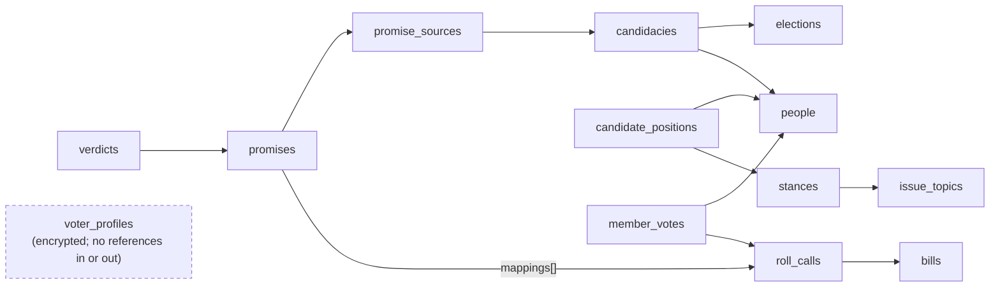

# Informed — ZeroDB Data Model

As of Oct 15, 2026 · Toby Morning · Companion to the Informed PRD

## Storage map

Informed runs on one ZeroDB project with no dedicated Postgres: NoSQL tables are the system of record, and vectors, the knowledge graph, files and events are derived from them. FastAPI reaches every primitive through the [ZeroDB MCP server](https://glama.ai/mcp/servers/AINative-Studio/ainative-zerodb-mcp-server/tree).

| Data | ZeroDB primitive | MCP tools | Why |
| --- | --- | --- | --- |
| All records: people, candidacies, bills, roll calls, member votes, promises, verdicts, positions, governance | NoSQL tables | `zerodb_create_table`, `zerodb_insert_rows`, `zerodb_query_rows`, `zerodb_update_rows` | System of record; schema-flexible as jurisdictions are added |
| Voter interest profiles (versioned) | NoSQL table, encrypted payload | same | Per-user documents; app-layer encryption |
| Promise, bill-summary, topic and stance embeddings | Vectors | `zerodb_embed_and_store`, `zerodb_semantic_search` | Promise-to-bill matching, free-text interest mapping |
| Evidence graph (candidate → promise → vote → stance) | Knowledge graph | `zerodb_graph_ontology_upsert`, `zerodb_graph_upsert_entity`, `zerodb_graph_create_edge`, `zerodb_graph_rag_search` | Grounded answers, traversal, contradiction detection |
| Archived campaign pages, bill text, transcripts | Files | `zerodb_upload_file`, `zerodb_generate_presigned_url` | Immutable snapshots behind every citation |
| Ingest, verdict and profile changes | Events | `zerodb_create_event`, `zerodb_subscribe_events` | Rebuild read models and send alerts without polling |
| Q&A sessions, reviewer feedback | Memory + RLHF | `zerodb_store_memory`, `zerodb_rlhf_*` | Short-lived agent context; QA decisions feed Focustem |

**NoSQL design rules** (because there are no joins or foreign keys)

1. **Deterministic ids from natural keys** — e.g. roll call `us-house:119-2:452`, member vote `us-house:119-2:452:B000944`. Re-ingesting the same record is an idempotent upsert, never a duplicate.
2. **Denormalize for the read** — each row carries the fields its main query filters on (a member vote carries `voted_at`, `vote_type`, `bill_id`, `topic_ids`), so every screen is one filtered query on one table.
3. **Embed what is always read together** — terms inside `people`, sponsors inside `bills`, mappings inside `promises`.
4. **Read models for hot pages** — `candidate_cards` is rebuilt from events, so the ballot view never aggregates at request time.
5. **Integrity lives in code** — a FastAPI repository layer validates references with Pydantic before every write; contract tests cover each rule.
6. **Append-only where history matters** — verdicts, positions and the provenance log are never updated in place; an `is_current` flag marks the live row.

## How the tables reference each other

The tables have no foreign keys, only id references that the repository layer checks. The voter's profile is deliberately cut off from everything else. Arrows point from a row to the row it references by id.



Scoring reads two paths: `member_votes` by person and topic for the voting record, and `promises` → `verdicts` for the Promise vs. Record view. `candidate_cards` (not shown) is a read model rebuilt from these tables by events. Governance tables (`methodology_versions`, `corrections`, `audit_runs`, `provenance_log`) reference rows by `target_table` + `target_id`.

## NoSQL table specs

There are 22 NoSQL tables, each created with `zerodb_create_table` and a field-type schema. Ids are strings built from natural keys. Per-user alignment scores are never stored: they are computed per request from `candidate_positions`, so no table links a person's priorities to a candidate.

### Reference and people

| Table | id pattern | Fields | Main queries |
| --- | --- | --- | --- |
| `jurisdictions` | `us-federal`, `eu`, `uk` | name, country_code, level, adapter_name, active | All active |
| `bodies` | `us-house`, `us-senate` | jurisdiction_id, name, chamber, seats | By jurisdiction |
| `districts` | OCD-ID (`ocd-division/country:us/state:ca/cd:19`) | body_id, name, state, valid_from, valid_to | By id after address geocode |
| `people` | `person:{bioguide}` or `person:{uuid}` | canonical_name, external_ids, photo_url, **terms[]** (body_id, district_id, party, start, end) | By id; by external id |
| `elections` | `us-2026-11-03-general` | jurisdiction_id, name, election_date, kind | Upcoming by jurisdiction |
| `candidacies` | `{election_id}:{district_id}:{person_id}` | election_id, district_id, person_id, person_name, party, is_incumbent, status | By (election, district) → ballot view |
| `issue_topics` | `{locale}:{slug}:v{n}` | parent_id, name, locale, taxonomy_version | Tree by locale |
| `stances` | `{topic_id}:{slug}` | topic_id, label, description, direction_code, wording_version | By topic |

### Legislative record

| Table | id pattern | Fields | Main queries |
| --- | --- | --- | --- |
| `bills` | `{body}:{session}:{number}` (`us-house:119:hr-1234`) | title, summary, status, introduced_on, subjects[], topic_ids[], **sponsors[]** (person_id, role, joined_on), text_file_id, source_url | By id; by topic; by sponsor |
| `roll_calls` | `{body}:{session}:{roll}` (`us-house:119-2:452`) | voted_at, question, vote_type, bill_id, amendment_ref, result, tally {yea, nay, present, not_voting}, is_bundled, topic_ids[], source_url, content_hash | By bill; by date range |
| `member_votes` | `{roll_call_id}:{bioguide}` | roll_call_id, person_id, position, *voted_at, vote_type, bill_id, topic_ids[], is_bundled* (copied from the roll call) | By (person, topic) → scoring; by roll call |

`vote_type` takes `final_passage`, `amendment`, `cloture`, `motion_to_recommit`, `procedural` or `other`; `position` takes `yea`, `nay`, `present` or `not_voting`. The italic fields are denormalized copies so scoring reads one table.

### Promises, verdicts and positions

| Table | id pattern | Fields | Main queries |
| --- | --- | --- | --- |
| `promise_sources` | `src:{sha256}` | candidacy_id, source_type, url, archived_file_id, captured_at | By candidacy |
| `promises` | `prm:{uuid}` | candidacy_id, person_id, source_id, quote_span, actor, action, object, direction, topic_id, stance_id, testable, extractor_version, confidence, vector_id, **mappings[]** (bill_id, roll_call_id, effect, confidence, qa_status), qa_pending | By person; QA queue (`qa_pending = true`) |
| `verdicts` | `{promise_id}:v{n}` | promise_id, person_id, verdict, confidence, methodology_version, qa_status, reviewed_by, reviewed_at, is_current, created_at | Current by person |
| `candidate_positions` | `{person_id}:{stance_id}:{method_ver}` | person_id, stance_id, s_value (−1 to 1), confidence, evidence_count, basis, is_current, computed_at | Current by person |
| `candidate_cards` (read model) | `{candidacy_id}` | person_name, party, district, photo_url, verdict_counts {kept, partial, broken, …}, say_do_gap, positions_summary, updated_at | By (election, district) |
| `candidate_statements` | `stm:{uuid}` | person_id, verdict_id, body, verified_by, posted_at | By verdict |

`verdict` takes `kept`, `partial`, `broken`, `no_opportunity`, `absent` or `not_testable`; `qa_status` takes `pending`, `approved` or `rejected`; `effect` takes `advances`, `opposes` or `neutral`.

### Governance, provenance and users

| Table | id pattern | Fields | Main queries |
| --- | --- | --- | --- |
| `methodology_versions` | `2026.1` | published_at, weights {tiers, evidence_blend, vote_types}, changelog_url, is_current | Current |
| `corrections` | `cor:{uuid}` | target_table, target_id, body, contact_email (optional), status, sla_due_at, resolved_at | Open by SLA |
| `audit_runs` | `aud:{date}` | run_at, methodology_version, max_delta, passed, report_file_id | Latest |
| `provenance_log` | `prov:{sha256}` | entity_table, entity_id, source_url, fetched_at, adapter_version | By entity |
| `voter_profiles` | `vp:{hmac(user_id)}` | version, locale, jurisdiction_ids, updated_at, key_ref, **payload** (encrypted interests) | By id only |

## Voter profile document

A profile row stores only what is needed to find and decrypt it. The interests themselves sit in an AES-256-GCM `payload` encrypted with a per-user data key, so ZeroDB never sees a voter's political priorities in clear text. The row id is an HMAC of the user id, so a database dump cannot be joined back to accounts.

```json
{
  "id": "vp:9f2c…e41a",
  "version": 7,
  "locale": "en-US",
  "jurisdiction_ids": ["us-federal"],
  "updated_at": "2026-10-15T19:20:00Z",
  "key_ref": "kms:informed/users/v1",
  "payload": "base64(AES-GCM ciphertext)"
}
```

Decrypted payload (validated by the Pydantic `InterestProfile` model):

```json
{
  "interests": [
    {"topic_id": "en-US:rx-drug-pricing:v1", "stance_id": "en-US:rx-drug-pricing:v1:lower-oop-costs",
     "tier": "primary", "intensity": 3, "dealbreaker": true, "note": null},
    {"topic_id": "en-US:broadband:v1", "stance_id": "en-US:broadband:v1:expand-rural",
     "tier": "secondary", "intensity": 2, "dealbreaker": false},
    {"topic_id": "en-US:public-lands:v1", "stance_id": "en-US:public-lands:v1:protect",
     "tier": "nice_to_have", "intensity": 1, "dealbreaker": false}
  ],
  "evidence_mode": "blend",
  "followed_person_ids": ["person:B000944"],
  "history": [{"version": 6, "changed_at": "2026-10-10T02:11:00Z"}]
}
```

**Rules**

- The tier sets the weight: `primary` 3.0, `secondary` 1.5, `nice_to_have` 0.5. The live values come from `methodology_versions` and are never hard-coded.
- Limits are enforced in the model: 1–5 primary, up to 8 secondary, and `dealbreaker` allowed only on primary interests.
- Each save bumps `version`. History keeps change dates, not prior contents, unless the user turns on "compare my past priorities".
- In anonymous mode no row is written: the same payload lives in the browser, and `/v1/alignment` accepts it inline.
- Deleting a profile deletes the row and shreds the data key.

**Implemented by story 14.1** in `backend/app/profiles/` — `models.py` (both shapes above, with every limit in this section enforced in the model), `crypto.py` (envelope encryption and the HMAC row ids) and `service.py` (encrypt-before-write, decrypt-after-read, version bump, shredding delete). Callers above that package work with plaintext `InterestProfile` objects and never touch a ciphertext, a key or a row id.

Three things the live run against the real project confirmed, rather than inferred from a fake (`backend/scripts/verify_profiles_live.py`; locked into CI by `backend/tests/test_profiles_live_shapes.py`):

- **The row as ZeroDB actually stores it is ciphertext.** Read back through the raw client, the row's full JSON carried no topic id, stance id, free-text note or user id, and the payload survived base64-decode, all 255 single-byte XORs and rot13 — "encrypted" tested rather than asserted.
- **The delete genuinely destroys the data.** Holding the live root key and the exact retained ciphertext, decryption after the delete failed; a freshly generated data key for the same voter did not open it either.
- **`locale`, `jurisdiction_ids` and `key_ref` belong on the outer row**, as above, because all three are needed *before* anything is decrypted (pick the taxonomy, pick the adapters, know which key scheme sealed the payload) and none of them is a political opinion.

The decrypted payload is **never logged** at any level, nor is key material, nor does any validation error message quote a topic id — a message reaching an HTTP 422 leaks as readily as a log line. Asserted by tests that capture every log record across a full save/read/export/delete cycle.

## Vector namespaces

Four namespaces hold 1024-dimension embeddings from ZeroDB's live `bge-m3` model via `zerodb_embed_and_store` (confirmed against the live API during story 1.2; this corrects an earlier 768-dimension assumption based on BGE-base). Each vector's metadata carries the NoSQL row id it was built from, so search hits resolve straight to records.

| Namespace | Document text | Metadata | Used by |
| --- | --- | --- | --- |
| `promises` | Atomic commitment text | promise_id, person_id, topic_id, cycle, testable | Mapping agent: promise → candidate bills |
| `bill_summaries` | Title + official summary (+ amendment purpose) | bill_id, body_id, session, topic_ids, roll_call_ids | Mapping agent; Q&A retrieval |
| `topics` | Topic name + definition, per locale | topic_id, locale, taxonomy_version | Free-text interest → topic suggestions |
| `stances` | Stance card wording | stance_id, topic_id, wording_version | Classifying a promise's or vote's direction |

HNSW indexes are created per namespace with `zerodb_create_vector_index`. Mapping proposes the top 10 bills per promise above 0.75 similarity; anything under 0.85 goes to the QA queue. Embeddings are rebuilt when `taxonomy_version` or `wording_version` changes, never patched in place. Voter free-text notes are embedded in memory only and never stored.

## Knowledge graph ontology

The evidence graph mirrors the NoSQL records the grounded agent must cite. It is registered once with `zerodb_graph_ontology_upsert`, written by the ingest and verdict agents, and queried with `zerodb_graph_rag_search` and `zerodb_graph_traverse`. Each entity's `canonical_name` is its NoSQL id, so every answer resolves back to a citable row.

| Source type | Predicate | Target type | Edge properties |
| --- | --- | --- | --- |
| `person` | `ran_in` | `candidacy` | party, is_incumbent |
| `candidacy` | `made_promise` | `promise` | source_id, captured_at |
| `promise` | `about` | `stance` | confidence |
| `promise` | `tested_by` | `roll_call` | effect, confidence, qa_status |
| `person` | `voted` | `roll_call` | position |
| `person` | `sponsored` | `bill` | role |
| `roll_call` | `on` | `bill` | vote_type, is_bundled |
| `bill` | `advances` / `opposes` | `stance` | confidence, method |
| `promise` | `has_verdict` | `verdict` | methodology_version, is_current |
| `stance` | `under` | `topic` | — |

- `voted` edges are written only for roll calls that some promise or bill-stance edge touches. That keeps the graph to evidence, not all ~600k votes per Congress.
- When a promise's verdict changes, ZeroDB's contradiction tracking (`zerodb_graph_contradictions_list`) supersedes the old `has_verdict` edge. The time-scoped history is kept and can be queried with `as_of`.
- The Q&A agent may answer only from a path that ends in a `roll_call`, `bill` or `promise` entity; otherwise it says there is no evidence.

## Files, events, memory and RLHF

**Files** (`zerodb_upload_file`) hold the immutable snapshots behind citations: archived campaign pages as HTML and PDF, bill text, and debate transcripts. Each file's metadata carries `sha256`, `source_url` and `captured_at`. NoSQL rows reference files by `file_id`; the UI serves them through short-lived presigned URLs, and server-side readers (promise extraction, integrity checks) read them with `ZeroDBClient.download_file`.

**An archive is only an archive if it reads back.** Storing a file means sending its bytes to ZeroDB's **multipart binary** upload route, not posting its metadata to the JSON route — the two look identical in their responses and only one stores anything. Every write of a file must be verifiable by reading it back and re-hashing it, and every repair path must check that rather than infer it from a surviving row. See the resolved open question below for the live finding and the mechanism.

**Events** (`zerodb_create_event`) are how rows, read models and alerts stay in sync without joins.

| Event type | Payload | Consumers |
| --- | --- | --- |
| `rollcall.ingested` | roll_call_id, bill_id, topic_ids | Position recompute; mapping agent; follower alerts |
| `promise.extracted` | promise_id, person_id | Mapping agent; QA queue |
| `mapping.reviewed` | promise_id, qa_status | Verdict agent |
| `verdict.published` | verdict_id, person_id, verdict | `candidate_cards` rebuild; graph edge update; follower alerts |
| `positions.recomputed` | person_id, methodology_version | `candidate_cards` rebuild |
| `methodology.published` | version | Full recompute + symmetry audit |
| `profile.updated` | profile id only (no contents) | Client cache bust |

**Memory** (`zerodb_store_memory`) keeps the Q&A agent's session context, scoped by `session_id`, with retention set to 1 day. In anonymous mode memory is not written at all.

**RLHF** (`zerodb_rlhf_agent_feedback`, `zerodb_rlhf_error`) records reviewer approvals and rejections of mappings and verdicts, along with user-flagged answers. That labeled set is the training data for distilling the extractor and classifier with Focustem.

## Privacy, retention and integrity

The user tables and the public-record tables are kept apart by design. No table, vector or graph entity combines a voter's interests with a candidate's score.

| Data | Retention | Rule |
| --- | --- | --- |
| `voter_profiles` | Until the user deletes it | Encrypted payload, HMAC id, key shredded on delete (story 14.1; the key's wrap lives in `voter_profile_keys` so deleting it is independent of the profile row) |
| Q&A memory | 1 day | Never written in anonymous mode |
| `corrections.contact_email` | 90 days after resolution | Optional field |
| Public-record tables, files, graph | Indefinite | Public data; full provenance |
| `provenance_log`, `verdicts`, `candidate_positions` | Indefinite, append-only | Never updated in place; reproducibility |

**Integrity checks** (written test-first, run in CI and nightly against production):

- Every `member_votes.roll_call_id` resolves to a `roll_calls` row, and every `candidacies.person_id` resolves to a `people` row.
- Every `kept`, `partial` or `broken` verdict has at least one approved mapping to a recorded roll call.
- Exactly one `is_current = true` row exists per (promise) in `verdicts` and per (person, stance) in `candidate_positions`.
- The denormalized fields on `member_votes` match their `roll_calls` row; any drift triggers a re-copy.
- Every NoSQL row with a `source_url` has a matching `provenance_log` entry, so no evidence goes untraced.
- Every row naming an `archived_file_id` can fetch that file back, and its bytes hash to what the row records. *Added after the story-9.1 file-retrievability bug got past all five checks above: those archives had correct rows, correct metadata and correct sha256 values with no stored object behind any of them, because each of the five asks a question about rows and none asks whether the evidence a row cites can actually be fetched. This check downloads every archived file, so it belongs in the nightly run and not on a request path.*

**Open questions**

- [x] Confirm `zerodb_query_rows` filter operators beyond `$contains` and `$lt` (e.g. `$in`, `$gte`, array contains) — the topic and date queries depend on them. **Resolved with a caveat (story 1.2):** server-side `filter` on ZeroDB's `/query` endpoint appeared to silently drop matching rows in live testing — a filter that an unfiltered read showed should match returned nothing. The typed ZeroDB client (`backend/app/zerodb/`) works around this today by also filtering client-side within each returned page. **Escalated to AINative** — if the server-side bug is fixed, the client-side workaround should be removed so filtering doesn't silently fail past the first page at scale (~600k rows per Congress).
- [ ] **Confirmed much worse (story 1.4): ZeroDB's server-side `/query` filter matches _nothing_, not merely some rows.** Measured live: a row inserted into `schema_versions` and then queried with `filter={"id": "<that id>"}` returned `total=0, data=[]` under both the bare `id` and the `row_data.id` spelling, while the same table read unfiltered returned it plainly. Every filtered read against live ZeroDB therefore runs entirely on the client's client-side fallback. Two consequences, both found and fixed in story 1.4:
  - The story 1.2 fallback only covered the **first page**. `get_row` asks for `limit=1`, so the fallback read `GET /rows?limit=1&skip=0` and tested exactly one row. Live, with three rows seeded behind one pre-existing row, `get_row` found none of the three. Since `get_row` is the find step of `upsert_row` and of the repository's reference check, that meant **a duplicate row on every re-ingest and a rejected reference for data that does exist**, on any table past its first page — reproduced live as `live row count ... is 2, expected 1` in the real `people` table. `ZeroDBClient._fallback_filtered_rows` now pages (500 rows per request, 50 pages maximum) and stops as soon as the caller's window is filled.
  - The ceiling is a real remaining limitation: a filtered read for a row beyond ~25k rows still reports it absent. Tolerable because the referenced parent tables (`people`, `roll_calls`) are orders of magnitude smaller, but **not** tolerable for a filtered read of `member_votes` at ~600k rows. **This is the single highest-value fix to request from AINative**, and `_fallback_filtered_rows` is the one place to delete once the server-side filter works.
  - Live row **order is unspecified**: a probe showed a pre-existing row returned between two rows inserted before and after it, so it is not insertion order. `skip`-based paging is sound, though — pages at `limit=2` returned all five rows exactly once with no repeats or gaps. No caller may assume position; `FakeZeroDBTransport.break_server_side_filter()` reproduces the filter behaviour so this cannot regress unnoticed in CI.
- [ ] Confirm per-table row limits and pagination ceilings for `member_votes` at ~600k rows per Congress. **Partially blocked (story 16.1):** the live load test couldn't run — this session's ZeroDB MCP connection (`mcp__ainative-zerodb__*`) authenticates to a different account than the "informed" project's own credentials, so MCP tools 404 on every table/row operation for this project. See `docs/spikes/16.1-zerodb-query-limits.md` for the diagnostic trail and a ready-to-run test procedure once that connection is fixed.
- [ ] Key management for `voter_profiles`: AINative KMS, or a cloud KMS? **Still open — deliberately unblocked rather than answered (story 14.1).** No AINative KMS integration exists, and provisioning a cloud KMS key is infrastructure work rather than application code (the same boundary story 1.6 drew around ZeroDB project provisioning). Story 14.1 therefore shipped a **local envelope-encryption scheme that is an explicit KMS stand-in**, architected so the swap changes neither the stored row shape nor any caller: a 32-byte root KEK from `$ZERODB_PROFILE_ROOT_KEY` (documented as a placeholder in `.env.example` and `docs/environments.md`) is the HKDF-SHA256 source for both the row-id HMAC key and a per-user key-wrapping key; each voter gets a **random** 32-byte AES-256-GCM data key, stored only in wrapped form in a separate `voter_profile_keys` table.
  - **Why the data key is random and not `HKDF(root, user_id)`:** a derived key cannot be shredded. Anyone holding the root key could re-derive it for any user id forever, making this table's own retention rule ("key shredded on delete") a false claim about a ciphertext that a backup still holds. Confirmed live: after a delete, the retained ciphertext could not be decrypted **with the live root key in hand**, and a replacement key for the same voter did not open it either.
  - **What the stand-in does not provide, and a real KMS would:** hardware-backed key custody, audited key use, automatic rotation, and a root key that application memory never holds. The acknowledged consequence is that an attacker who reads the process environment **and** `voter_profile_keys` can decrypt profiles — a weaker boundary than story 14.1's "via KMS" acceptance criterion implies, and the one part of that story which infrastructure rather than code must finish. **Rotating the root key today makes every stored profile unreadable**; no re-wrap migration exists yet.
  - **Migration cost when a KMS arrives:** replace the internals of `ProfileRootKey` and `ProfileKeyring.wrap_key_for` with `GenerateDataKey`/`Decrypt` calls, and change `KEY_REF` from `local-envelope:informed/profiles/v1` to `kms:informed/users/v1`. Every row records its own `key_ref` precisely so a part-migrated table stays readable row by row rather than needing a flag day. Nothing in the models, the service, the API or the row shape changes.
- [ ] **New (story 14.1):** `voter_profiles`' schema in `app/bootstrap.py` was missing the `key_ref` and `jurisdiction_ids` fields this document's own example row shows; both are now created. A second table, **`voter_profile_keys`** (id, wrapped_key, salt, key_ref, created_at), holds the wrapped per-user data keys. It is infrastructure rather than one of the 22 tables above, and it is deliberately **not** a column on the profile row: "delete shreds the key" has to be a write the profile row's lifecycle cannot undo, so that restoring a `voter_profiles` backup does not restore the key with it. Its row id is the same `vp:{hmac(user_id)}`, so the table names no accounts, and `wrapped_key` is sealed under a KEK derived from a root key that lives outside the database.
- [ ] **New (story 1.2):** ZeroDB has no upsert-by-natural-key — `POST /rows` always appends, so the repository layer (story 1.4) must implement idempotent upsert itself (query-by-id, then `PUT`/insert) rather than relying on the API to dedupe. `PUT`/`DELETE` also require ZeroDB's own internal row UUID, not Informed's natural-key id, and `PUT` replaces a row wholesale (a naive partial update will drop the row's `id` field) — the repository layer needs to read-merge-write, not patch.
- [x] **New (story 1.2):** Live rate limit observed at 60 req/min on the standard tier. Bootstrap (story 1.3) creates 22 tables + 4 vector namespaces + 1 ontology (27 operations) — close enough to this ceiling that the bootstrap script must pace/throttle its calls explicitly rather than assume headroom. **Addressed (story 1.3):** the bootstrap module paces every call through an injectable `pace()` callback (default: a monotonic-clock pacer keeping calls ≥1.1s apart).
- [ ] **New (story 1.3):** `zerodb_create_vector_index`'s real endpoint is `POST /public/v1/vectors/index` with `project_id` as a **query parameter**, not `/projects/{project_id}/embeddings/index` as the MCP tool description's naming would suggest — confirmed against the live OpenAPI schema. Two further live-confirmed facts change how any vector-namespace bootstrap must work: (1) **a namespace must already contain at least one vector before it can be indexed** (404 otherwise — there is no standalone "create namespace" step, a namespace exists only once something is embedded into it); (2) **the endpoint is NOT idempotent** — calling it twice for the same namespace does not error and does not return the existing index, it silently creates a second, independently-named index (`idx_{namespace}_{type}_{timestamp}`). There is also no live "list existing indexes" endpoint any more: `/public/zerodb/vectors/indexes` answers 410 (deprecated, superseded by `/database/vectors/stats`, which reports per-namespace vector *counts*, not configured indexes). Story 1.3's bootstrap works around this by seeding one marker vector per namespace before indexing it, and by tracking which namespaces it has already indexed in its own `schema_versions` row — the only idempotency guard available, since ZeroDB itself cannot answer "does this namespace already have an index". **Escalate to AINative:** either make index creation idempotent (return/no-op on an existing index for the namespace) or restore a non-deprecated "list indexes" read, so a caller doesn't have to self-track this.
- [ ] **New (story 1.3):** Mid-session, this story's live credentials (`local.env`'s `ZERODB_API_KEY`/`ZERODB_PROJECT_ID` for the "informed" project) stopped being accepted for that same project. Earlier in the same session, with the same unmodified `local.env`, the identical key/project pair successfully called `list_tables` (0 tables, confirming a clean project), `embed_and_store` (confirming live 1024-dimension `bge-m3` vectors) and `create_vector_index` (201, twice, confirming the non-idempotent behaviour documented above). Partway through the same session, every project-scoped call — across three different URL shapes (`/projects/{id}`, `/projects/{id}/database/tables`, `/public/zerodb/{id}/database/tables`) — started failing with `403 API_KEY_PROJECT_MISMATCH: This API key is not scoped to this project`, and did not recover on retry (checked repeatedly, including after a delay). Account-level calls with the same key (`GET /projects` listing 100 projects, `GET /openapi.json`) kept working throughout, and the "informed" project id was absent from that account-level project list once the mismatch began — ruling out a local parsing bug (the env file was verified byte-for-byte unchanged and the key/project id values parse cleanly) and pointing at a live, server-side credential/scope change (expiry, rotation, or a project re-association) that happened during the session rather than a pre-existing misconfiguration. **This blocked completing the live bootstrap run** — see story 1.3's PR for what was and was not created in the live project before access was lost, and re-run the bootstrap once a working `informed`-scoped key is confirmed (e.g. via a fresh `zerodb_renew_token` or a newly minted key) with `GET /projects/{project_id}/database/tables` as the smoke test.
- [ ] **New (story 5.1):** No Congress.gov API key was available for the House roll-call ingest — `prd.md`'s "Data sources and coverage" table notes this source needs "a free API key" via an interactive signup at api.data.gov/signup/ that this agent cannot complete. A live, unauthenticated probe of `https://api.congress.gov/v3/house-vote/118/2/452` confirmed the host is reachable and the URL scheme (`/v3/house-vote/{congress}/{session}[/{roll}]`) is correct, but every call — including the OpenAPI schema itself — answers `403 API_KEY_MISSING` with no public fallback, so nothing about the real response shape could be confirmed directly against the live API. `backend/app/ingest/house_rollcalls.py` was built and fully tested (100% line coverage) against a hand-built fixture whose field names and enum values come from the Library of Congress's own published documentation (`https://github.com/LibraryOfCongress/api.congress.gov/blob/main/Documentation/HouseRollCallVoteEndpoint.md`, fetched live 2026-10-16) rather than a captured real response — same posture as story 1.6's ZeroDB project-provisioning blocker. `scripts/load_house_rollcalls.py` is wired and ready; it needs only `CONGRESS_GOV_API_KEY` set (documented in `.env.example`) to run for real, and this story's PR is where the live verification results belong once a key exists.
- [ ] **New (story 3.3) — the live project is 3.5x over its storage plan, and inserts fail intermittently with `402`.** Partway through the first live verification run, a `POST .../panel_reviews/rows` was refused with `402 storage_limit_exceeded`: `current_storage_gb: 1.7558` against `storage_limit_gb: 0.5`, an overage of 1.2558 GB, with `action_required: "Upgrade your plan to increase storage limit or delete existing data"`. Minutes later, with nothing changed and no data deleted, a diagnostic probe inserted and deleted a row successfully in **three different tables** (`schema_versions`, `corrections`, `panel_reviews`), an in-place `PUT` of an existing `stances` row succeeded, and a full re-run of `scripts/verify_panel_review_live.py` completed every check including 281 row inserts. So the limit is **enforced non-deterministically rather than as a hard block** — the same request shape is refused and then accepted — which makes it a latent source of partial writes on every bulk path this codebase has (`scripts/seed_taxonomy.py`, `scripts/seed_stances.py`, `scripts/backfill_panel_review.py`, and every ingest run in epics 5-8). None of those is transactional (`app/repositories/base.py` is explicit that nothing here is atomic), so a mid-run 402 leaves a half-written corpus that only a re-run repairs. Two things worth noting about the reported numbers: the account reports 1.76 GB stored while the whole project holds **832 rows across 8 non-empty tables** (`people` 539, `stances` 201, `issue_topics` 80, `districts` 7, `bodies` 2, `jurisdictions` 1, `methodology_versions` 1, `schema_versions` 1) plus the 281 new `panel_reviews` rows — kilobytes of row data, so the 1.76 GB is almost certainly vectors, indexes or per-project overhead rather than rows, and `GET /projects/{id}/database/stats` answers 404 so there is no way to see the breakdown. **Escalate to AINative:** (1) raise the limit or explain what the 1.76 GB is, (2) make the limit deterministic so a bulk writer can fail fast rather than partway, and (3) restore a storage-breakdown read. In the meantime `ZeroDBClient` does **not** retry a 402 (it is not a 429 and retrying an over-quota write is pointless), so a bulk script's failure is loud and a re-run is the documented repair.
- [ ] **New (story 3.3):** `panel_reviews` (id, subject_table, subject_id, subject_version, decision, reviewer_id, decided_at, reason, proposal_id, proposed_label, proposed_description, proposed_name, previous_label, previous_description, previous_name) holds the cross-partisan advisory panel's decisions about the wording in `issue_topics` and `stances` — prd.md's "stance cards and issue taxonomy reviewed by a cross-partisan advisory panel before each release; wording changes are versioned and public". Infrastructure rather than one of the 22 tables above, like `voter_profile_keys`: no section of this document describes it, prd.md rather than datamodel.md is what requires it, and both tables it judges are fixed here at their documented field lists. A separate table rather than status columns on the reviewed rows for four reasons argued in `backend/app/repositories/models.py`'s `PanelReview`: the seeders restate every row on each run and would wipe a status field; a decision is history rather than state, and the acceptance criterion is literally "the review history is visible"; this document fixes both tables' fields and `Stance` pins the absence of extras as the mechanism behind "no stance is preselected"; and 281 rows are live and read by four shipped endpoints. The id is content-addressed (`pr:{sha256}` over the decision's own content), like `provenance_log`'s and for the same reason — it makes the write idempotent with no `is_current` bookkeeping, which is what lets the grandfathering backfill be re-run safely. Measured live 2026-10-16: all 15 fields round-trip including the 7 nulls, and `subject_version` comes back a real `int` (the gate compares it with `==`, and a stringified version would make every approval invisible).
- [ ] **New (story 3.3) — the live taxonomy and stance corpus is `grandfathered`, which is NOT panel approval, and 281 rows owe a real review.** Stories 3.1 and 3.2 published 80 `issue_topics` and 201 `stances` rows before the review workflow existed, and prd.md lists "who sits on the cross-partisan advisory panel, and how members are chosen" as an open question — so no panel has ever reviewed any of it. Marking those rows `approved` would have been a false entry in the one table whose value is that its claims are true; leaving them unmarked would have emptied every gated read. They are therefore marked with a fifth decision value, `grandfathered`: it passes the publish gate (so nothing goes dark) and is explicitly not approval, `reviewer_id` is the literal `informed:story-3.3-backfill` rather than a person, each row's `reason` says in words that it is "NOT panel-approved", and `GET /v1/panel/queue` reports all 281 as still owing a real cross-partisan review. Confirmed live after the run: 281 ledger rows, all `grandfathered`, **zero** `approved`. This is a standing product debt, not a resolved item — it closes when a real panel exists and decides, which is a governance decision rather than an engineering one.
- [x] **New (story 13.5) — ZeroDB's memory API has NO retention/TTL field, so "Q&A memory | 1 day" is this codebase's promise to keep, not ZeroDB's.** Measured live against `POST /projects/{id}/database/memory`: the full request schema is `{agent_id, session_id, role, content, memory_metadata, project_id, embedding}` with nothing resembling a TTL, and a request sending `ttl_seconds: 86400` **and** a top-level `expires_at` anyway returned 200 and **silently dropped both** — neither appears in the response and nothing expires. `/api/v1/memory/decay-config` is a decay-RATE and LRU-eviction-LIMIT knob (`default_decay_rate`, `eviction_limit`), not time-based retention, and answered 500 on a live GET. **Addressed (story 13.5):** retention is enforced twice in `app/agent_memory/` — a read guard (`SessionMemoryService.recall` never returns a turn past its window even while the row exists, so a late or failed sweep is never voter-visible) and a sweep (`sweep_expired_session_memory`, registered in `app.scheduling.jobs.default_jobs()` as `sweep_qa_session_memory` every 6 hours, so the row genuinely stops existing). The window is written into `memory_metadata.expires_at` (which DOES round-trip verbatim), with a fallback to ZeroDB's own `created_at`, so a row keeps the window it was written under and no row is immortal for want of a marker. `ZeroDBClient.store_memory` deliberately takes **no** TTL parameter: one would read as "the server enforces this" to every later reader. If ZeroDB ever adds a real TTL, `test_a_live_memory_record_carries_no_ttl_the_request_asked_for` is where that shows up, and the sweep can then be deleted in favour of it.
- [ ] **New (story 13.5) — `DELETE .../database/memory/{id}` on a row that no longer exists answers 500, not 404.** The body is `{"detail": "Failed to delete memory: 404: Memory not found", "error_code": "INTERNAL_ERROR", "next_action": "retry"}` — a 404 hiding inside a 500, and the only place in this API where the status code lies about what happened. It cost twice before being handled: `ZeroDBClient`'s retry policy treated it as transient and burned four attempts against the ~60 req/min ceiling on a row that will never come back, and every caller that legitimately races a delete (the retention sweep against a concurrent sweep, `forget_session` against the sweep, a cleanup script after either) saw `ZeroDBServerError` where "already gone" is the truth — the first live run of `scripts/verify_evidence_graph_and_memory_live.py` reported a cleanup failure for rows that had in fact been deleted. **Worked around (story 13.5):** `_request` gained a `reinterpret` hook, consulted on every error *before* the transient check so a corrected non-transient error ends the retry loop immediately; `delete_memory` is its only user, and only a 500 whose detail says the memory was not found is reinterpreted (a genuine 500 stays a retried `ZeroDBServerError`). **Escalate to AINative** alongside the `/rows` filter bug above; delete the translation and the hook when the endpoint answers 404.
- [x] **New (story 13.5) — unlike `/rows`, the memory endpoint's `session_id` filter DOES work server-side.** Confirmed live: one row written under a fresh session uuid was read back by exactly `GET .../database/memory?session_id=<uuid>`, and the unfiltered read agreed. So `list_memories` needs no client-side fallback and none is built — a second paging workaround nobody needs is a second thing to get wrong. Two further live constraints worth recording: `session_id` and `memory_id` **must be UUIDs** (a readable `"qa:session-1"` is rejected `422 uuid_parsing`, which is also the privacy-correct constraint — an opaque uuid cannot encode a user id, a district or an address), and `limit` is capped at 100, so the sweep pages with `skip`.
- [x] **New (story 13.1) — the live registered ontology IS this document's predicate table, verified field by field.** Read from the real "informed" project 2026-10-17: 8 entity types and 11 predicates, every `source`/`target` matching the "Knowledge graph ontology" table above, with `advances` and `opposes` registered as the two predicates this document's single `advances / opposes` row means. `app.evidence_graph.DOCUMENTED_PREDICATE_TABLE` transcribes the table independently of `app.bootstrap.ONTOLOGY_PREDICATES` and a test asserts the two are equal, so a drift between the code and this document fails CI rather than going unnoticed; `EvidenceGraphWriter.verify_ontology()` is the live check, and `scripts/write_evidence_graph.py` refuses to write a single edge if it reports drift.
- [ ] **New (story 13.1) — the evidence graph holds `ran_in` edges and nothing else, because nothing else has both endpoints in the live data yet.** `person -> ran_in -> candidacy` is written for real (3 edges from the 3 live `candidacies` rows, each traversed back and confirmed to resolve to a citable row by its NoSQL id). Everything else is blocked on data rather than on code. `candidacy -> made_promise -> promise` and `promise -> about -> stance` are code-complete (story 9.3's extractor merged mid-story and `scripts/write_evidence_graph.py` writes an edge per `promises` row) but the live project holds **0** promise rows and 3 `promise_sources`, because nobody has run `scripts/extract_promises.py` against it — so that count becomes real with no code change. `person -> voted -> roll_call` needs `member_votes`, which needs Congress.gov, which needs `CONGRESS_GOV_API_KEY` — absent in every environment, and the reason `app.scheduling.jobs` reports `load_house_rollcalls` as BLOCKED. `scripts/write_evidence_graph.py` reads all three tables and writes an edge per row it finds, so the counts become real with no code change. **No synthetic vote or promise edge was written to make the graph look fuller**: an uncitable edge in the evidence graph is worse than a missing one, since the agent's entire contract is that every claim resolves to a primary source.
- [ ] **New (story 13.3) — the no-recommendations guardrail is a deterministic rule-based classifier, and the obfuscation gap is real.** `app/agent_policy/` gates the eventual story 13.2 agent and passes all 50 red-team prompts (`app/agent_policy/red_team.py`, mirrored in `backend/tests/features/no_recommendations.feature` with a test asserting the two hold the same 50) while refusing none of 24 pinned legitimate evidence questions. What it buys: determinism (the property that makes a 50-prompt regression suite meaningful), zero latency and cost, a named rule on every decision so a false positive is debuggable, and structural immunity to prompt injection. What it does **not** buy, **measured rather than estimated**: after the 50 went green the classifier was probed with batches of ordinary plain-English asks written without reference to the rules, and caught **1 of 10**, then **0 of 8** against the improved version (rising to 4 of 8 after more rules). The misses were not obfuscated — "help me decide", "who's your favourite", "nudge me in a direction", "any thoughts on who's better". **Each round of rules closes the phrasings that prompted it and leaves the next round of unseen paraphrases roughly half-caught**, while precision held at 100% throughout. Obfuscation (homoglyphs, base64), an ask split across turns, and languages outside the seven covered (en, es, fr, de, zh, pt, ja, ar) are a further, harder gap that substring matching cannot defend at all. `test_the_measured_recall_gap_is_what_the_docs_claim` pins the specific remaining misses and **fails if a later classifier closes one**, so this entry cannot go stale. The consequence for planning: the 50-prompt suite is a regression test, not a sufficiency test, and the semantic classifier is not a refinement — it is what actually closes the paraphrase gap, so **story 13.2 should not ship its agent without one**. The intended end state is **both** layers: this one as a cheap deterministic floor an LLM cannot talk its way past, plus a semantic classifier behind it once 13.2 exists — replacing this with an LLM classifier alone would downgrade the one property a neutrality guarantee most needs, that it behaves the same way every time.
- [x] **New (story 9.1, found by story 9.3, fixed 2026-10-17) — ZeroDB has TWO file-upload routes and only one stores any bytes.** Both answer `200` with a `file_id`, which is how a half-working Files integration shipped silently:
  - `POST /projects/{id}/database/files` takes a JSON `FileCreate` body. The live OpenAPI schema calls its identically-shaped sibling (`/projects/{id}/files/metadata`) *"Upload file metadata only (no binary file) — use this endpoint when you've already uploaded the file to MinIO"*. It writes a `files` row and nothing else.
  - `POST /projects/{id}/files/upload` takes `multipart/form-data` with the bytes in a `file` part (`key` and a JSON-string `metadata` as form fields). It creates the project's bucket if needed, stores the object, writes the row, and returns the `size_bytes` and `sha256_hash` **it measured over the body it received** — a response carrying `sha256_hash` is therefore proof an object exists.

  Story 1.2 wired `ZeroDBClient.upload_file` to the first one. Every file Informed archived through story 9.1 consequently had a correct metadata row — right `file_key`, right sha256, right `source_url` — with no stored object behind it, and every presigned download answered `404` (`NoSuchBucket` before the bucket existed, `NoSuchKey` after). Measured live for all six of story 9.1's campaign-site files.

  **Fixed:** `upload_file` takes a required `content: bytes` and posts multipart to the binary endpoint; `ZeroDBClient.download_file(file_id)` reads bytes back via `GET /projects/{id}/files/{file_id}/content`; presigned URLs work unchanged once bytes exist (both paths verified live, byte-for-byte). `size_bytes` is gone from `upload_file`'s signature — it was a caller-supplied number the metadata route believed without checking. Two live details worth keeping: a session-level `Content-Type: application/json` on the httpx client **silently replaces** the generated `multipart/form-data; boundary=...` header and ZeroDB then rejects the body as malformed JSON (`422 Field required`), so the transport sets no session default; and `GET /projects/{id}/files/storage-status` reported `provisioning`/`ready: false` for a project whose uploads worked fine, so it is not a usable precondition.

  **Residual data debt, not an engineering question:** three `promise_sources` rows from story 9.1 (`src:1009ac74…` electjon.com, `src:241a025e…` pelosiforcongress.org, `src:baa11483…` mikecollinsga.com) name archives whose bytes were never stored, and all three pages have since changed — so the captured bytes are provably unrecoverable by anyone, and those rows are citations that can never be honoured. Three fresh, fully retrievable captures of the same three sites now exist alongside them. `scripts/repair_unretrievable_archives.py` reports the state of every row and mends the ones whose pages are still byte-identical; retiring the unmendable three is a deliberate decision for a human, and needs `promise_sources` deletion plumbing (a repository `delete`, plus `list_files`/`delete_file` on the client) that does not exist yet.
